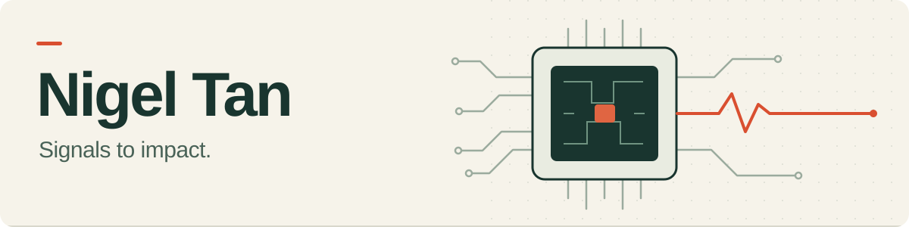

  <a href="https://tanjinchun.com/">Portfolio</a> &nbsp;·&nbsp;
  <a href="https://www.linkedin.com/in/tanjinchun/">LinkedIn</a> &nbsp;·&nbsp;
  <a href="https://orcid.org/0009-0000-6850-8570">Research</a> &nbsp;·&nbsp;
  <a href="https://www.credly.com/users/tanjinchun">Credentials</a> &nbsp;·&nbsp;
  <a href="mailto:nigeltanjc@gmail.com">Email</a>

I'm **Tan Jin Chun (Nigel)**, a physical design engineer in Kuala Lumpur. I build tools for chip-design workflows and research uncertainty-aware monitoring.

## Hackathon projects

<table>
  <tr>
    <td width="50%" valign="top">
      
       <strong><a href="https://github.com/jinchuntan/jaga-scam-protection">Jaga</a></strong> 
      <strong>3rd place</strong> · Codex Malaysia 2026  
      Scam checks across web, Telegram and an ESP32 voice companion.  
      <a href="https://github.com/jinchuntan/jaga-scam-protection">Code</a> · <a href="https://jagacare.vercel.app/">Demo</a> · <a href="https://devpost.com/software/jaga-the-ai-scam-circuit-breaker">Award &amp; story</a>
    </td>
    <td width="50%" valign="top">
      
       <strong><a href="https://github.com/jinchuntan/waddle-mock">Waddle</a></strong> 
      <strong>Winner · Dollar Track</strong> · AI.SEA $1 Sprint  
      Supplier discovery and procurement conversations for SMEs.  
      <a href="https://github.com/jinchuntan/waddle-mock">Code</a> · <a href="https://waddle.fovea.space/">Product</a> · <a href="https://www.fovea.space/#recognition">Recognition</a>
    </td>
  </tr>
  <tr>
    <td width="50%" valign="top">
      
       <strong><a href="https://github.com/jinchuntan/kintsuginotes">Kintsugi Notes</a></strong> 
      <strong>Iteration Machine · Special Prize</strong> · DSH Hacks V1  
      Turns study mistakes into explanations and targeted practice.  
      <a href="https://github.com/jinchuntan/kintsuginotes">Code</a> · <a href="https://kintsuginotes.vercel.app/">Demo</a> · <a href="https://devpost.com/software/kintsugi-notes-ynkma0">Award</a>
    </td>
    <td width="50%" valign="top">
      
       <strong><a href="https://github.com/jinchuntan/whisp">Persephone</a></strong> 
      <strong>Top 5 finalist · Robotics &amp; Physical AI</strong> · Agentic AI Build Week  
      An ESP32 voice badge that turns audience questions into a shared Q&amp;A feed.  
      <a href="https://github.com/jinchuntan/whisp">Code &amp; firmware</a> · <a href="https://github.com/jinchuntan/whisp/blob/main/docs/ARCHITECTURE.md">Architecture</a> · <a href="https://www.fovea.space/#recognition">Recognition</a>
    </td>
  </tr>
</table>

Jaga, Waddle and Persephone are team projects with <a href="https://github.com/NathanHor22">Nathan Hor</a>. Kintsugi Notes is an individual project.

Research: [ConfoSense](https://github.com/jinchuntan/confosense) — forecasting, conformal prediction and reliable building alerts.

More projects &amp; recognition

| Project | Highlight | Explore |
| :--- | :--- | :--- |
| Presence Postcard | 1st place · AR Track, Pacific Portal XR 2026 | [Project overview](https://www.fovea.space/#recognition) |
| Purrmit | Top 3 finalist · Lovable Healthcare Operations | [Code](https://github.com/jinchuntan/purrmit) · [Demo](https://purrmit.lovable.app/) |
| Quipus | Conversation memory and compact recording hardware | [Code](https://github.com/jinchuntan/quipus) |
| RoomLab | Multiplayer spatial learning prototype | [Code](https://github.com/jinchuntan/RoomLab) |

Also: [ProcurePilot](https://github.com/jinchuntan/procurepilot) · [GotongFlow](https://github.com/jinchuntan/gotongflow) · [OCI field tools](https://github.com/jinchuntan?tab=repositories&q=oci-)

## Open source

<!-- CONTRIBUTIONS:START -->

<table>
  <tr>
    <td colspan="3">
<picture>
  <source media="(max-width: 600px)" srcset="./assets/contributions-compact-709d53388c68.svg">
  
</picture>
    </td>
  </tr>
  <tr>
    <td width="33%" valign="top">
      <h4>IC design</h4>
      <a href="https://github.com/search?q=is%3Apr+author%3Ajinchuntan+repo%3AThe-OpenROAD-Project%2FOpenROAD&amp;type=pullrequests">OpenROAD</a> 3 open 
      <a href="https://github.com/search?q=is%3Apr+author%3Ajinchuntan+repo%3AThe-OpenROAD-Project%2FOpenROAD-flow-scripts&amp;type=pullrequests">OpenROAD flow scripts</a> 2 open 
      <a href="https://github.com/search?q=is%3Apr+author%3Ajinchuntan+repo%3AKLayout%2Fklayout&amp;type=pullrequests">KLayout</a> 1 closed 
      <a href="https://github.com/search?q=is%3Apr+author%3Ajinchuntan+repo%3AVLSIDA%2FOpenRAM&amp;type=pullrequests">OpenRAM</a> 2 merged · 1 open 
      <a href="https://github.com/search?q=is%3Apr+author%3Ajinchuntan+repo%3Alibrelane%2Flibrelane&amp;type=pullrequests">LibreLane</a> 1 open
    </td>
    <td width="33%" valign="top">
      <h4>AI &amp; data</h4>
      <a href="https://github.com/search?q=is%3Apr+author%3Ajinchuntan+repo%3Alangchain-ai%2Flangchainjs&amp;type=pullrequests">LangChain.js</a> 4 open 
      <a href="https://github.com/search?q=is%3Apr+author%3Ajinchuntan+repo%3Ahuggingface%2Fdatasets&amp;type=pullrequests">Hugging Face Datasets</a> 1 merged · 7 open 
      <a href="https://github.com/search?q=is%3Apr+author%3Ajinchuntan+repo%3Ahuggingface%2Flerobot&amp;type=pullrequests">LeRobot</a> 1 open 
      <a href="https://github.com/search?q=is%3Apr+author%3Ajinchuntan+repo%3Aollama%2Follama&amp;type=pullrequests">Ollama</a> 2 open 
      <a href="https://github.com/search?q=is%3Apr+author%3Ajinchuntan+repo%3Apandas-dev%2Fpandas&amp;type=pullrequests">pandas</a> 1 open 
      <a href="https://github.com/search?q=is%3Apr+author%3Ajinchuntan+repo%3Aroot-project%2Froot&amp;type=pullrequests">ROOT</a> 1 open
    </td>
    <td width="33%" valign="top">
      <h4>Developer tools</h4>
      <a href="https://github.com/search?q=is%3Apr+author%3Ajinchuntan+repo%3Aastral-sh%2Fruff&amp;type=pullrequests">Ruff</a> 2 closed 
      <a href="https://github.com/search?q=is%3Apr+author%3Ajinchuntan+repo%3Aprettier%2Fprettier&amp;type=pullrequests">Prettier</a> 1 closed 
      <a href="https://github.com/search?q=is%3Apr+author%3Ajinchuntan+repo%3Apytest-dev%2Fpytest&amp;type=pullrequests">pytest</a> 1 open 
      <a href="https://github.com/search?q=is%3Apr+author%3Ajinchuntan+repo%3Asnakemake%2Fsnakemake&amp;type=pullrequests">Snakemake</a> 1 open 
      <a href="https://github.com/search?q=is%3Apr+author%3Ajinchuntan+repo%3A8f4e%2F8f4e&amp;type=pullrequests">8f4e</a> 12 merged · 3 open 
      <a href="https://github.com/search?q=is%3Apr+author%3Ajinchuntan+repo%3AChristianHandy%2FFleetPilot&amp;type=pullrequests">FleetPilot</a> 2 merged 
      <a href="https://github.com/search?q=is%3Apr+author%3Ajinchuntan+repo%3Apiyush588%2FvibeCI&amp;type=pullrequests">vibeCI</a> 1 merged 
      <a href="https://github.com/search?q=is%3Apr+author%3Ajinchuntan+repo%3Apyrite-wiki%2Fpyrite&amp;type=pullrequests">Pyrite</a> 1 merged
    </td>
  </tr>
</table>

<strong>More repositories</strong> 
<a href="https://github.com/search?q=is%3Apr+author%3Ajinchuntan+repo%3Alanggenius%2Fdify&amp;type=pullrequests">langgenius/dify</a> 3 open

<strong>Explore all 54 pull requests</strong>

| Repository | Pull request | Status |
| :--- | :--- | :--- |
| 8f4e/8f4e | <a href="https://github.com/8f4e/8f4e/pull/1115">#1115 · docs(compiler): add a runnable public API quickstart</a> | Open |
| 8f4e/8f4e | <a href="https://github.com/8f4e/8f4e/pull/1114">#1114 · test(compiler): cover unsigned shifts and notZero at runtime</a> | Open |
| 8f4e/8f4e | <a href="https://github.com/8f4e/8f4e/pull/1113">#1113 · fix(tokenizer): avoid temporary source-line pairs</a> | Merged |
| 8f4e/8f4e | <a href="https://github.com/8f4e/8f4e/pull/1111">#1111 · fix!: use allocation-unit terminology for memory layouts</a> | Merged |
| 8f4e/8f4e | <a href="https://github.com/8f4e/8f4e/pull/1101">#1101 · fix(semantic-utils): remove unused block depth cache</a> | Merged |
| 8f4e/8f4e | <a href="https://github.com/8f4e/8f4e/pull/1100">#1100 · fix(stack-analyzer): validate localSet float widths</a> | Merged |
| 8f4e/8f4e | <a href="https://github.com/8f4e/8f4e/pull/1093">#1093 · fix(tokenizer): reject non-ASCII entity names</a> | Merged |
| 8f4e/8f4e | <a href="https://github.com/8f4e/8f4e/pull/1091">#1091 · fix(memory-reference-resolver): preserve float64 metadata bounds</a> | Open |
| 8f4e/8f4e | <a href="https://github.com/8f4e/8f4e/pull/1090">#1090 · fix(memory-planner): preserve float64 array value types</a> | Merged |
| 8f4e/8f4e | <a href="https://github.com/8f4e/8f4e/pull/1089">#1089 · fix(tokenizer): preserve exponent signs in compile-time expressions</a> | Merged |
| 8f4e/8f4e | <a href="https://github.com/8f4e/8f4e/pull/1088">#1088 · fix(wasm-codegen): preserve one-element array initializers</a> | Merged |
| 8f4e/8f4e | <a href="https://github.com/8f4e/8f4e/pull/1087">#1087 · fix(tokenizer): reject overflowing hexadecimal and binary literals</a> | Merged |
| 8f4e/8f4e | <a href="https://github.com/8f4e/8f4e/pull/1082">#1082 · fix(tokenizer): invalidate cached ASTs after source edits</a> | Merged |
| 8f4e/8f4e | <a href="https://github.com/8f4e/8f4e/pull/1080">#1080 · fix(project-preparser): preserve note block content</a> | Merged |
| 8f4e/8f4e | <a href="https://github.com/8f4e/8f4e/pull/1078">#1078 · fix(compiler): reject invalid array sizes</a> | Merged |
| astral-sh/ruff | <a href="https://github.com/astral-sh/ruff/pull/29454">#29454 · &#91;flake8-use-pathlib&#93; Add an autofix for the last path component (PTH206)</a> | Closed |
| astral-sh/ruff | <a href="https://github.com/astral-sh/ruff/pull/29453">#29453 · &#91;flake8-use-pathlib&#93; Add an autofix for extension access (PTH122)</a> | Closed |
| ChristianHandy/FleetPilot | <a href="https://github.com/ChristianHandy/FleetPilot/pull/111">#111 · Add tests for scheduler settings and automatic updates</a> | Merged |
| ChristianHandy/FleetPilot | <a href="https://github.com/ChristianHandy/FleetPilot/pull/110">#110 · Add tests for the example Slack notification plugin</a> | Merged |
| huggingface/datasets | <a href="https://github.com/huggingface/datasets/pull/8847">#8847 · Hide GPUs before spawning TensorFlow data workers</a> | Open |
| huggingface/datasets | <a href="https://github.com/huggingface/datasets/pull/8846">#8846 · Restore packaged type information and public re-exports</a> | Open |
| huggingface/datasets | <a href="https://github.com/huggingface/datasets/pull/8845">#8845 · Copy existing tensors without a PyTorch warning</a> | Open |
| huggingface/datasets | <a href="https://github.com/huggingface/datasets/pull/8844">#8844 · Warn once when resuming a shuffled dataset</a> | Open |
| huggingface/datasets | <a href="https://github.com/huggingface/datasets/pull/8843">#8843 · Fix mask resizing in the semantic segmentation guide</a> | Open |
| huggingface/datasets | <a href="https://github.com/huggingface/datasets/pull/8842">#8842 · Include the config name when no data files are found</a> | Open |
| huggingface/datasets | <a href="https://github.com/huggingface/datasets/pull/8841">#8841 · Handle UTF-8 BOMs in every JSON input file</a> | Open |
| huggingface/datasets | <a href="https://github.com/huggingface/datasets/pull/8840">#8840 · Fix indices buffer loading in Dataset.from_buffer</a> | Merged |
| huggingface/lerobot | <a href="https://github.com/huggingface/lerobot/pull/5004">#5004 · Add image size and JPEG quality controls to dataset viewer</a> | Open |
| KLayout/klayout | <a href="https://github.com/KLayout/klayout/pull/2516">#2516 · Use explicit LEF files without directory scanning</a> | Closed |
| langchain-ai/langchainjs | <a href="https://github.com/langchain-ai/langchainjs/pull/11975">#11975 · feat(mcp-adapters): support progress timeout resets</a> | Open |
| langchain-ai/langchainjs | <a href="https://github.com/langchain-ai/langchainjs/pull/11974">#11974 · fix(google-common): preserve anyOf tool schemas</a> | Open |
| langchain-ai/langchainjs | <a href="https://github.com/langchain-ai/langchainjs/pull/11973">#11973 · fix(core): preserve routes and per-input errors in router batches</a> | Open |
| langchain-ai/langchainjs | <a href="https://github.com/langchain-ai/langchainjs/pull/11972">#11972 · fix(openai): preserve request options when streaming</a> | Open |
| langgenius/dify | <a href="https://github.com/langgenius/dify/pull/44372">#44372 · refactor(web): share workflow comment queries and mutations</a> | Open |
| langgenius/dify | <a href="https://github.com/langgenius/dify/pull/44360">#44360 · refactor(web): use Console Query in the install form</a> | Open |
| langgenius/dify | <a href="https://github.com/langgenius/dify/pull/44359">#44359 · fix(web): avoid redundant indexing notifications</a> | Open |
| librelane/librelane | <a href="https://github.com/librelane/librelane/pull/1053">#1053 · KLayout: make DEF layer map optional</a> | Open |
| ollama/ollama | <a href="https://github.com/ollama/ollama/pull/19097">#19097 · Avoid reusing runners after cancelled startup</a> | Open |
| ollama/ollama | <a href="https://github.com/ollama/ollama/pull/19096">#19096 · Handle servers that ignore download ranges</a> | Open |
| pandas-dev/pandas | <a href="https://github.com/pandas-dev/pandas/pull/71269">#71269 · BUG preserve error bars when plot labels are changed</a> | Open |
| piyush588/vibeCI | <a href="https://github.com/piyush588/vibeCI/pull/14">#14 · Add Bun test runner detection</a> | Merged |
| prettier/prettier | <a href="https://github.com/prettier/prettier/pull/20312">#20312 · Keep method chains stable when the last argument expands</a> | Closed |
| pyrite-wiki/pyrite | <a href="https://github.com/pyrite-wiki/pyrite/pull/1007">#1007 · fix: use the package version in OpenAPI</a> | Merged |
| pytest-dev/pytest | <a href="https://github.com/pytest-dev/pytest/pull/15197">#15197 · Escape unencodable names in PYTEST_CURRENT_TEST</a> | Open |
| root-project/root | <a href="https://github.com/root-project/root/pull/23747">#23747 · &#91;core&#93; Fix shell detection with multiline commands</a> | Open |
| snakemake/snakemake | <a href="https://github.com/snakemake/snakemake/pull/4346">#4346 · docs: document the minimum Pixi version for contributors</a> | Open |
| The-OpenROAD-Project/OpenROAD | <a href="https://github.com/The-OpenROAD-Project/OpenROAD/pull/11856">#11856 · dpl: respect oriented fixed macro footprints</a> | Open |
| The-OpenROAD-Project/OpenROAD | <a href="https://github.com/The-OpenROAD-Project/OpenROAD/pull/11815">#11815 · odb: avoid moved port names on buffered driver nets</a> | Open |
| The-OpenROAD-Project/OpenROAD | <a href="https://github.com/The-OpenROAD-Project/OpenROAD/pull/11814">#11814 · odb: require matching layers for pin abutment</a> | Open |
| The-OpenROAD-Project/OpenROAD-flow-scripts | <a href="https://github.com/The-OpenROAD-Project/OpenROAD-flow-scripts/pull/4696">#4696 · fix(drc): preserve violations in nested report categories</a> | Open |
| The-OpenROAD-Project/OpenROAD-flow-scripts | <a href="https://github.com/The-OpenROAD-Project/OpenROAD-flow-scripts/pull/4695">#4695 · fix(report): classify metric generation errors as failures</a> | Open |
| VLSIDA/OpenRAM | <a href="https://github.com/VLSIDA/OpenRAM/pull/332">#332 · docs: clarify setup and macro compiler options</a> | Open |
| VLSIDA/OpenRAM | <a href="https://github.com/VLSIDA/OpenRAM/pull/331">#331 · Report configuration syntax errors through the normal diagnostic</a> | Merged |
| VLSIDA/OpenRAM | <a href="https://github.com/VLSIDA/OpenRAM/pull/329">#329 · Load configuration files by path</a> | Merged |

Public upstream PRs · Updated 2026-10-21 · <a href="https://github.com/jinchuntan/jinchuntan/actions/workflows/update-profile.yml">Auto-refresh ~6h</a>

<!-- CONTRIBUTIONS:END -->

## Featured in

<table>
  <tr>
    <td width="38%" valign="middle">
      
    </td>
    <td width="62%" valign="middle">
      <strong>Hybrid Solar Lighting System</strong> 
      Modular lighting powered by solar energy.  
      <a href="https://springwise.com/climate-change/concept-for-hybrid-lighting-solar-system-could-power-houses/"><strong>Springwise ↗</strong></a> · Innovation feature 
      <a href="https://sdg7youth.org/yseh/hybrid-solar-lighting-system/"><strong>SDG7 Youth ↗</strong></a> · Project spotlight
    </td>
  </tr>
</table>

## Toolkit

| Focus | Tools & interests |
| :--- | :--- |
| Chip design | Physical design · STA · Power integrity · Innovus · Voltus |
| Software | Python · Tcl · C/C++ · TypeScript |
| Research & hardware | Time-series forecasting · Conformal prediction · ESP32 |

Beyond code: Monash industry advisory panel · Agora ambassador · Oracle ACE Associate.
